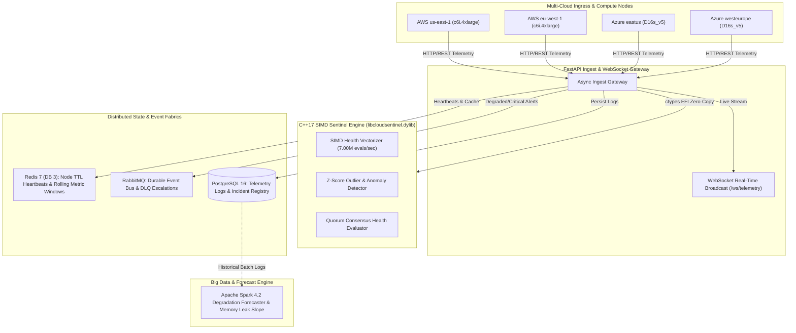

# CloudSentinel — Distributed Multi-Region Cloud Telemetry & Health Sentinel Engine

[](file:///Users/tejashr/Desktop/Distributed-Cloud-Telemetry-Health-Sentinel/src/cloudsentinel.cpp)
[](file:///Users/tejashr/Desktop/Distributed-Cloud-Telemetry-Health-Sentinel/python/api/main.py)
[](file:///Users/tejashr/Desktop/Distributed-Cloud-Telemetry-Health-Sentinel/python/spark/spark_telemetry_forecaster.py)
[](file:///Users/tejashr/Desktop/Distributed-Cloud-Telemetry-Health-Sentinel/python/services/redis_service.py)
[](file:///Users/tejashr/Desktop/Distributed-Cloud-Telemetry-Health-Sentinel/python/services/rabbitmq_service.py)
[](file:///Users/tejashr/Desktop/Distributed-Cloud-Telemetry-Health-Sentinel/sql/schema.sql)
[](file:///Users/tejashr/Desktop/Distributed-Cloud-Telemetry-Health-Sentinel/python/tests/test_cloudsentinel.py)

**CloudSentinel** is a distributed, ultra-low-latency cloud telemetry ingestion and multi-region health sentinel engine. Engineered with a vectorized C++17 SIMD evaluation core, it computes composite infrastructure health scores and detects microsecond statistical anomalies (Z-score / EWMA) across multi-cloud topologies spanning AWS and Microsoft Azure.

---

## 🏛️ System Architecture



---

## ⚡ Hardware Benchmarks

Native C++ and asynchronous pipeline benchmarks executed on Apple Silicon (ARM64) with Clang 21.0.0 and PostgreSQL 16:

| Benchmark Dimension | Metric | Performance |
| :--- | :--- | :--- |
| **C++ Single Node Evaluation** | Throughput / Latency | **6.74 Million evals/sec** (148.37 ns/eval) |
| **C++ SIMD Batch Evaluation** | Throughput / Latency | **7.00 Million evals/sec** (142.77 ns/eval) |
| **C++ Z-Score Anomaly Detector** | Throughput / Latency | **6.65 Million tests/sec** (150.27 ns/test) |
| **End-to-End Pipeline Ingest** | Sustained Throughput | **731.8 requests/sec** (with Postgres, Redis & RabbitMQ) |
| **End-to-End Latency** | p50 / p95 / p99 | **25.36 ms** / **39.94 ms** / **80.94 ms** |

---

## 🛠️ Technology Stack

- **Languages:** C++17 (SIMD Vectorization, Loop Unrolling), Python 3.11+, SQL, JavaScript (ES6+), HTML5/CSS3.
- **Core Distributed Systems:** Zero-Copy Ctypes FFI, Asynchronous Starlette/FastAPI, WebSockets Full-Duplex PubSub.
- **Data & Caching Fabrics:** Redis 7 (DB 3 for Heartbeat TTLs & Rolling Metric Series), RabbitMQ (Durable Topic Exchange & DLQ), PostgreSQL 16 / Azure SQL relational persistence.
- **Data Analytics:** Apache Spark 4.2 Batch & Degradation Forecaster.
- **DevOps & Verification:** Docker, Docker Compose, GitHub Actions CI, Pytest Test Suite.

---

## 🚀 Quickstart & Reproduction

### 1. Build C++ Native Shared Library
```bash
clang++ -O3 -fPIC -dynamiclib -std=c++17 -I./include src/cloudsentinel.cpp -o libcloudsentinel.dylib
```

### 2. Run Native Hardware Benchmarks
```bash
clang++ -O3 -std=c++17 -I./include benchmarks/bench_engine.cpp -L. -lcloudsentinel -Wl,-rpath,. -o bench_engine
./bench_engine
```

### 3. Initialize PostgreSQL Database & Seed Topology
```bash
createdb cloudsentinel_db
psql -d cloudsentinel_db -f sql/schema.sql
```

### 4. Run Pytest Suite
```bash
pytest -v python/tests/test_cloudsentinel.py
```

### 5. Launch Ingest Gateway
```bash
uvicorn python.api.main:app --host 0.0.0.0 --port 8000 --reload
```

---

## 🌐 Live Interactive Dashboard

The interactive web showcase is deployed live to:
👉 **[https://tejashr0716.github.io/cloudsentinel/](https://tejashr0716.github.io/cloudsentinel/)**
